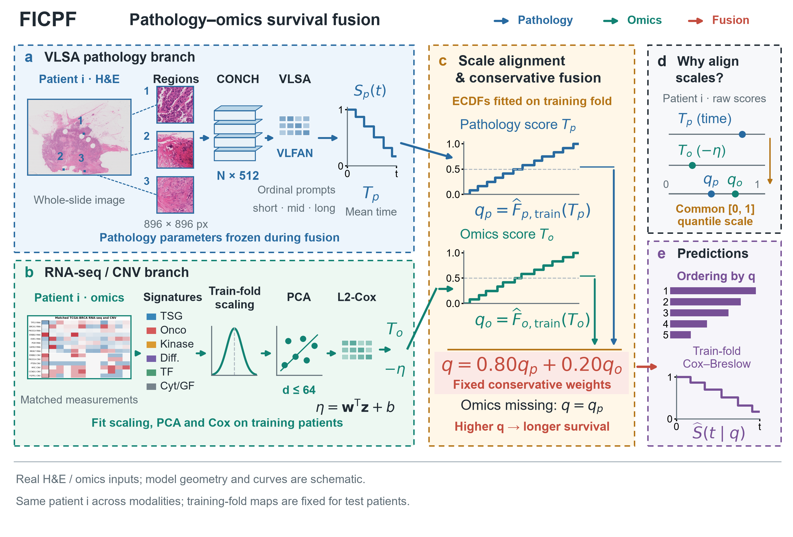

# FICPF GitHub 精简发布版

FICPF（Frozen Inductively Calibrated Pathomic Fusion）是一种面向病理-组学生存分析的冻结式归纳校准融合方法。方法采用基于 CONCH 图像块特征的 VLSA 病理预测，在每个外层训练折内拟合 RNA-seq/CNV PCA-Cox 分支；随后将两种预测映射到训练折经验分位数空间，并按固定的病理/组学权重 `0.80/0.20` 融合。



## 锁定结果

- VLSA 五队列宏平均 C-index：`0.695782`。
- FICPF 五队列宏平均 C-index：`0.705017`。
- 配对宏平均增益：`+0.009235`，95% bootstrap CI 为 `[0.0016, 0.0169]`。
- 数据集：BLCA、BRCA、GBMLGG、LUAD、UCEC，均采用患者级 outer 5-fold。
- VLSA 病理主干使用 `42、3404、3405` 三个完整训练种子进行稳定性分析，15 个“种子 × 队列”点估计全部正向。

正式主结果仍是锁定的 seed 42 结果，多种子实验只用于稳定性验证，不反向替换主表。

## 本次更新

- 比较方法补齐为 ABMIL、TransMIL、ILRA、DSMIL、VLSA、MCAT、CAT-with-TPL 和 FICPF，共八种。原始实验编号保留，图表展示名称不再添加 `-CONCH`。
- 补入 ILRA、DSMIL 的 25 折结果、逐患者预测及审计记录；未完成五队列评估的 MOTCat 不进入主比较。
- 补入六种方法的生存曲线指标及 100 份 MIL 测试曲线。FICPF 相对 VLSA 的 IBS 和 KM 校准误差下降，但 hinge MAE 增加；D-calibration 折数不是合并样本的整体检验。
- 补入实际纳入患者对应的切片和图像块统计，共 2,831 名患者、3,529 张切片、15,615,143 个图像块。
- 补入固定输入的参数与计算开销记录。含曲线输出和均值生存时间积分的中位耗时为 VLSA 25.61 ms、FICPF 62.17 ms，不代表全队列平均或纯网络前向耗时，不据此声称 FICPF 推理更快。
- 更新彩色方法主图、八方法比较图和曲线指标图。中文 Word 初稿暂不公开，也不在仓库另建新的论文附件。

MCAT 与 CAT-with-TPL 的保留适配实验使用全队列事件时间分箱，与训练折内分箱的病理对照不同，比较图中的星号保留这一说明。

详细结果见 [八方法性能汇总](result/ficpf-eight-method-comparison/eight_method_dataset_summary.csv)、[六方法曲线指标](result/ficpf-six-method-curve-comparison/macro_curve_metrics.csv) 和 [数据集统计](result/ficpf-dataset-resource-audit/dataset_statistics.csv)。

## 发布范围

该目录是面向 GitHub 的白名单精简包。它保留：

- FICPF 全部分析和制图代码；
- 固定数据划分、生存表和逐患者锁定预测；
- 主结果、消融、敏感性、鲁棒性和多种子统计结果；
- 已公开的历史草稿、参考文献和正式图件；历史草稿不代表当前中文稿；
- 环境信息与逐文件 SHA256 清单。

它不包含原始 WSI、CONCH 权重、patch 特征、VLSA checkpoint、大型组学表、W&B、日志、缓存和失败实验。大型组学表的文件名、放置位置和 SHA256 见 [DATA.md](DATA.md)。

当前预算为公开文件合计不超过 50 MiB、单个文件小于 25 MiB，Git 内部文件不计入。方法图所需的少量 TCGA 示例缩略图和区域图属于图件素材，不是原始全分辨率 WSI。

## 安装

```bash
python -m venv .venv
# Linux/macOS: source .venv/bin/activate
# Windows: .venv\Scripts\activate
python -m pip install -r requirements.txt
```

## 无大数据校验

```bash
python tools/verify_ficpf_release.py
```

该命令不需要被省略的组学表，会检查文件清单、包体积、主结果、多种子结果和禁止混入的训练产物。

新增结果的详细校验（不训练模型）：

```bash
python tools/verify_current_results.py --recompute-c-index
```

重新计算六方法曲线指标：

```bash
python tools/evaluate_additional_baseline_curves.py --output-dir result/reproduced_curve_comparison
```

该命令读取仓库内保留的测试曲线、配置、固定划分及训练折时间网格，不需要大型组学表。曲线逐患者积分耗时较长，可先用 `--datasets blca --folds 0` 检查单折。复算输出使用独立目录，不覆盖锁定结果。

## 复算边界

1. 使用 `result/` 中锁定逐患者预测进行汇总复核和制图，可直接运行。
2. 完整组件消融、外部基线统一比较、重新拟合 PCA-Cox 或组学损坏实验，需要按 [DATA.md](DATA.md) 补齐组学表。
3. 从原始 WSI 重训 VLSA 还需要上游 VLSA 代码、CONCH 权重和 patch 特征，不属于本精简分析仓库。

完整英文说明见 [README.md](README.md)，许可证和第三方边界见 [NOTICE.md](NOTICE.md)。
