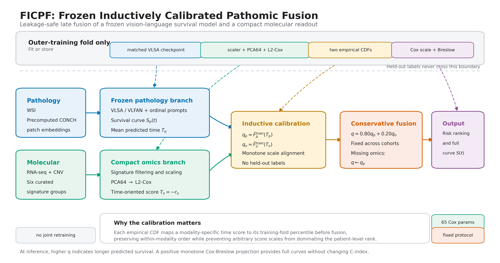
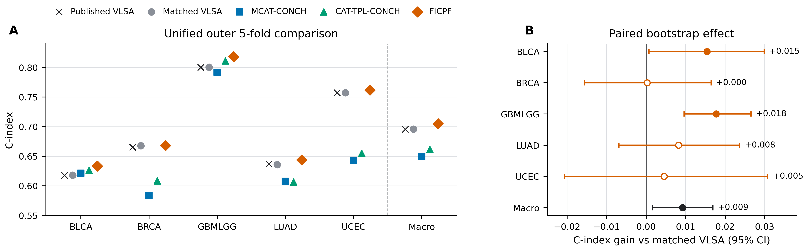
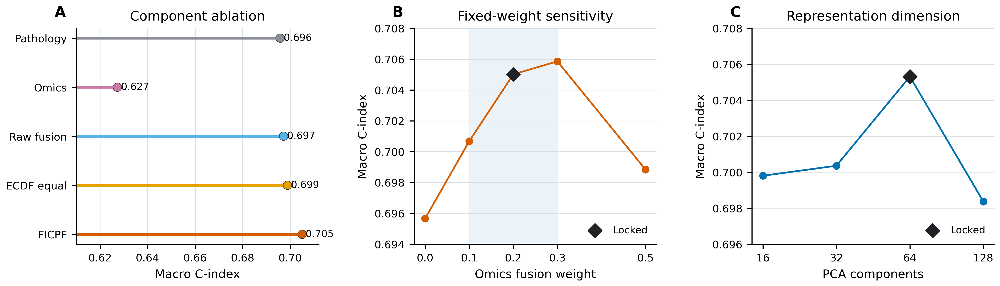
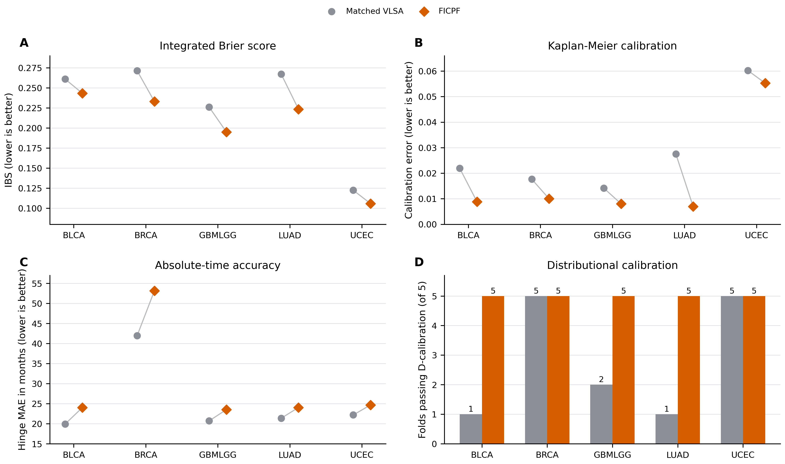
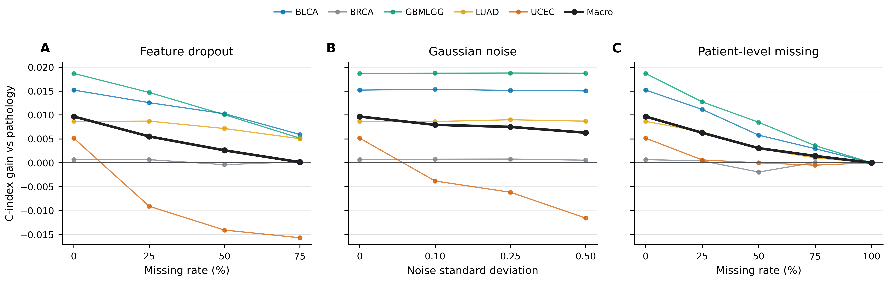
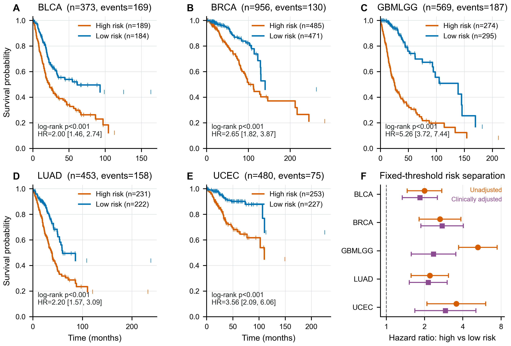

# Frozen Inductively Calibrated Pathomic Fusion for Robust Multimodal Survival Analysis in Computational Pathology

**Authors:** [To be completed]

**Affiliations:** [To be completed]

**Corresponding author:** [To be completed]

## Abstract

Whole-slide pathology and molecular profiles provide complementary prognostic evidence, but joint survival models can become unstable in small, censored cohorts when modality-specific predictions have incompatible scales. We propose Frozen Inductively Calibrated Pathomic Fusion (FICPF), which preserves a trained VLSA-CONCH pathology branch and adds a compact molecular branch using signature-linked RNA-seq/CNV, principal component analysis, and an L2-regularized Cox model. Within each outer training fold, pathology-predicted survival times and molecular scores are independently mapped to percentile space and combined using a fixed 0.80/0.20 weight, with pathology fallback for missing molecular data. On five TCGA cohorts under patient-level outer five-fold evaluation, FICPF achieved a macro C-index of 0.7050 versus 0.6958 for matched VLSA, a paired gain of 0.0092 (95% bootstrap confidence interval, 0.0016-0.0169), and exceeded unified MCAT-CONCH and CAT-TPL-CONCH reproductions. A fixed, outcome-independent percentile threshold separated out-of-fold high- and low-risk groups in all cohorts (log-rank p<0.001; hazard ratios, 2.00-5.26), with significant associations after available clinical adjustment. FICPF reduced macro integrated Brier score from 0.2296 to 0.2001 and increased folds passing D-calibration from 14/25 to 25/25, although absolute-time error worsened. FICPF improves risk ranking and population-level calibration at low incremental cost while limiting negative transfer from weak or missing molecular inputs.

**Keywords:** computational pathology; survival analysis; vision-language model; multimodal fusion; calibration

## 1. Introduction

Cancer prognosis is central to treatment planning, surveillance, and patient stratification. Conventional survival models rely primarily on clinical stage, histologic grade, and a limited set of biomarkers, leaving much of the information contained in whole-slide images (WSIs) unused. Digital pathology and multiple-instance learning have enabled patient-level predictions from thousands of image patches without pixel-level annotations. However, WSI models remain vulnerable to patch redundancy, spatial heterogeneity, small patient cohorts, and the substantial censoring that characterizes many cancer survival datasets.

Pathology foundation models and vision-language models provide a new route to more transferable and interpretable WSI representations. CONCH learns a pathology-specific visual-language space from large-scale image-text supervision [4]. VLSA subsequently introduces ordinal prognosis prompts and aligns WSI representations with language concepts ranging from poor to favorable survival [5]. This design provides both strong pathology prediction and a degree of semantic interpretation. Nevertheless, the primary VLSA input remains pathological morphology. Cancer outcome also depends on gene expression, copy-number alterations, and pathway activity, which may distinguish molecularly different patients with similar tissue appearance.

Existing multimodal survival methods typically use cross-attention, bilinear fusion, or multimodal Transformers to optimize pathology and molecular representations jointly. MCAT, for example, uses molecular embeddings to query WSI patches through co-attention [3], while CAT-with-TPL combines cross-modal attention with textual prompt learning [6]. These high-capacity models can learn complex interactions, but they introduce three practical risks. First, modalities differ in noise, coverage, and prediction scale, so an unreliable molecular branch can disrupt an already strong pathology branch. Second, uncensored events are often much fewer than patients, making deep fusion modules prone to high fold-to-fold variation. Third, joint training increases memory use, tuning cost, and sensitivity to missing molecular inputs.

We study a more conservative question: given a reliable vision-language pathology predictor, can lightweight molecular evidence improve survival prediction without retraining the pathology backbone? The challenge is not only to fit a molecular model, but also to combine two predictors whose numerical ranges, marginal distributions, and reliability differ. We therefore propose Frozen Inductively Calibrated Pathomic Fusion (FICPF). FICPF freezes VLSA-CONCH, compresses signature-linked RNA-seq and copy-number variation (CNV) into a low-dimensional Cox readout, and maps each modality to its own training-fold percentile space. A small fixed molecular weight limits negative transfer, and explicit pathology fallback preserves inference when molecular data are unavailable.

The main contributions are as follows:

1. We introduce a pathomic survival framework that adds patient-specific molecular evidence while preserving a trained VLSA vision-language pathology branch.
2. We propose training-fold inductive distribution calibration to align pathology-predicted survival time and molecular Cox scores in a common percentile space without using held-out labels.
3. We use a single conservative fusion weight across cohorts and an explicit missing-molecular fallback to limit negative transfer in low-event and low-coverage settings.
4. We evaluate the method on five TCGA cohorts under matched outer five-fold splits and report end-to-end multimodal comparators, component ablations, a patient-correspondence negative control, parameter sensitivity, survival-curve metrics, molecular corruption tests, complexity, and numerical seed stability.

## 2. Related work

### 2.1. Multiple-instance learning for whole-slide pathology

A WSI can contain thousands to tens of thousands of patches and cannot be processed as a conventional image. Attention-based multiple-instance learning established a permutation-invariant way to aggregate bags while retaining instance-level relevance scores [12]. CLAM extended this paradigm with clustering constraints for data-efficient weakly supervised pathology modeling [2], while TransMIL modeled correlations among instances with a Transformer [13]. For prognosis, DeepAttnMISL combined attention-guided MIL with censored survival learning directly from WSIs [14]. These developments established the feasibility of weakly supervised WSI prognosis, but redundant tissue patches, spatially heterogeneous disease, right-censored labels, and limited patient-level sample sizes remain important challenges.

### 2.2. Pathology vision-language models and ordinal survival prompts

Large-scale self-supervised pathology encoders such as UNI and Prov-GigaPath have improved transferable tile and slide representations [21,22]. Pathology vision-language foundation models additionally map tissue morphology into a medically meaningful semantic space. CONCH provides pathology-specific visual and textual representations learned through image-text supervision [4]. VLSA uses CONCH features together with ordinal survival prompts and a vision-language feature aggregation network to predict a discrete survival distribution [5]. More recent MPRSurv work enriches survival prompts and introduces uncertainty-aware visual ranking [20]. Unlike models that return only an opaque scalar risk, these prompt-based approaches relate predictions to ordered prognostic concepts. FICPF does not alter VLSA image encoding, prompt learning, or WSI aggregation. Instead, it treats the trained VLSA model as a frozen pathology predictor.

### 2.3. Multimodal pathology-omics survival modeling

Pathology and molecular measurements provide complementary views of tumor state. Pathomic Fusion modeled explicit interactions among histology, cell-graph, and genomic representations [15], and the pan-cancer PORPOISE study subsequently demonstrated interpretable image-omic prognosis across 14 cancer types [16]. MCAT uses pathway-level molecular representations as queries in a co-attention mechanism over WSI patches [3]. MOTCat imposes global structural consistency through optimal-transport matching [17], SURVPATH models dense interactions between biological pathways and histology [18], and multimodal prototyping compresses both modalities into interpretable prototype tokens [19]. CAT-with-TPL further introduces textual prompt learning to guide visual feature selection and cross-modal interaction [6]. Recent pan-cancer work has also explored cancer-aware expert mixtures and zero-shot transfer [30]. Such end-to-end approaches can represent nonlinear relationships, but they may be unstable when the molecular branch is weak or events are sparse. FICPF addresses a different setting: it preserves a strong pathology model and investigates whether inductively calibrated late fusion can add molecular information with limited capacity and limited interference.

### 2.4. Survival risk calibration and late fusion

The Cox proportional-hazards model remains an important approach for censored outcomes in limited-sample settings [7]. DeepSurv, DeepHit, and discrete-time neural survival models extend survival learning to nonlinear risk functions or directly estimated event-time distributions [23-25]. Regardless of model class, discrimination, probability error, and calibration measure different properties and should be evaluated under censoring-aware procedures [27-29]. Late fusion can combine independently trained predictors, but raw risks, probabilities, and expected survival times are generally not comparable across modalities. FICPF uses empirical distribution mapping as a nonparametric alignment step. Standardization, PCA, Cox fitting, empirical distributions, and survival-curve projection are all estimated within the outer training fold. Unlike procedures that re-estimate fusion weights from held-out labels or test distributions, this design preserves an inductive evaluation contract.

## 3. Methods

### 3.1. Problem formulation and framework

For patient \(i\), let \(X_i^p\) denote a bag of pathology patch embeddings, \(x_i^o\) the molecular feature vector, \(t_i\) the observed follow-up time, and \(e_i\in\{0,1\}\) the event indicator. The objective is to predict patient survival ordering and complete survival curves under right censoring. Each outer fold \(k\) contains a training set \(\mathcal D_k^{\mathrm{train}}\) and a test set \(\mathcal D_k^{\mathrm{test}}\). The test fold is used only for final evaluation and does not contribute to preprocessing, PCA, Cox fitting, empirical distributions, fusion weights, checkpoint selection, or other model choices.

FICPF comprises five stages: a frozen pathology branch, a compact molecular branch, training-fold inductive calibration, conservative fusion with missing-modality fallback, and monotone survival-curve reconstruction (Fig. 1).

**Figure 1. Overview of FICPF.** A matched VLSA-CONCH model provides frozen pathology survival curves and mean predicted survival times. Signature-linked RNA-seq/CNV features are processed by training-fold standardization, PCA64, and an L2-regularized Cox model. The two time-oriented scores are independently mapped through training-fold empirical cumulative distribution functions and combined using a fixed pathology/molecular weight of 0.80/0.20. Missing molecular inputs trigger pathology fallback. Complete survival curves are reconstructed by a monotone training-fold Cox-Breslow projection.

### 3.2. Frozen pathology survival branch

The pathology branch is the matched VLSA-CONCH reproduction [4,5]. Precomputed 512-dimensional CONCH patch embeddings are aggregated by the VLFAN module using ordinal survival prompts. Given \(K\) ordered time intervals, the model predicts discrete hazards \(h_{ij}\), from which the patient survival curve is

\[
S_i^p(t_j)=\prod_{r=1}^{j}(1-h_{ir}).
\tag{1}
\]

Following the SurvivalEVAL mean-prediction contract, linear interpolation of \(S_i^p\) yields the pathology-oriented predicted survival time \(T_i^p\). Larger values indicate longer predicted survival.

FICPF neither modifies nor jointly retrains the pathology network. Saved outer-training and outer-test predictions from the matched raw final checkpoint are treated as fixed inputs. This isolates the contribution of molecular modeling and calibrated fusion from changes in pathology optimization, early stopping, or checkpoint selection.

### 3.3. Compact molecular survival branch

The molecular input consists of RNA-seq and CNV variables associated with six gene groups distributed with CAT-with-TPL: tumor suppressor genes, oncogenes, protein kinases, cell differentiation markers, transcription factors, and cytokines and growth factors. For each listed gene, available columns ending in `_rnaseq` or `_cnv` are retained. This yields 3062, 3189, 2832, 3096, and 123 molecular variables for BLCA, BRCA, GBMLGG, LUAD, and UCEC, respectively.

Within outer fold \(k\), a `StandardScaler` is fitted to training patients only. Randomized principal component analysis [26] then reduces the standardized variables to

\[
d_k=\min(64,n_k^{\mathrm{train}}-1,p_k),
\tag{2}
\]

where \(p_k\) is the number of retained molecular variables. The primary randomized PCA seed is fixed to 42.

An L2-regularized Cox proportional-hazards readout is fitted to \(z_i\in\mathbb R^{d_k}\). With linear predictor \(\eta_i=w^\top z_i+b\), the objective is

\[
\mathcal L_{\mathrm{Cox}}=
-\frac{1}{\sum_i e_i}
\sum_{i:e_i=1}
\left[
\eta_i-
\log\sum_{j:t_j\ge t_i}\exp(\eta_j)
\right]
+\lambda\frac{\lVert w\rVert_2^2}{d_k}.
\tag{3}
\]

We use \(\lambda=0.10\), Adam with learning rate 0.02, and 1200 optimization steps. The molecular time-oriented score is \(T_i^o=-\eta_i\), so larger scores indicate longer predicted survival in both modalities.

### 3.4. Training-fold inductive distribution calibration

The pathology mean survival time and molecular Cox score have unrelated ranges and marginal distributions. Direct addition can therefore allow the numerically wider modality to dominate. For modality \(m\in\{p,o\}\), FICPF estimates the empirical cumulative distribution function using outer-training patients only:

\[
\widehat F_m^{\mathrm{train}}(z)=
\frac{1}{n_k^{\mathrm{train}}}
\sum_{j\in\mathcal D_k^{\mathrm{train}}}
\mathbb 1(T_j^m\le z).
\tag{4}
\]

The calibrated scores are

\[
q_i^p=\widehat F_p^{\mathrm{train}}(T_i^p),\qquad
q_i^o=\widehat F_o^{\mathrm{train}}(T_i^o).
\tag{5}
\]

Both scores are thus expressed as positions in their respective training distributions. No test labels or test distribution statistics are used. The empirical CDF is monotone and causes no pairwise inversion within a modality, although finite samples can map nearby test scores to the same percentile and create ties.

### 3.5. Conservative fusion and missing-molecular fallback

The final FICPF score is

\[
q_i=(1-\alpha)q_i^p+\alpha q_i^o,\qquad \alpha=0.20.
\tag{6}
\]

The same fixed value is used for every cohort and outer fold. It is not adapted to cohort identity, validation performance, or test performance. The deliberately small molecular contribution allows patient-specific molecular evidence to adjust pathology ordering while limiting negative transfer when the molecular branch is weak.

When a patient's molecular measurements are unavailable, inference explicitly reverts to \(q_i=q_i^p\). Missing molecular data therefore do not disable pathology-only prediction and do not require a learned multimodal imputation network.

### 3.6. Monotone survival-curve reconstruction

The scalar \(q_i\) directly defines the ordering used for concordance evaluation. Complete survival curves are reconstructed for IBS, D-calibration, Kaplan-Meier calibration, and MAE. Training percentiles are clipped to \([0.5/n_k^{\mathrm{train}},1-0.5/n_k^{\mathrm{train}}]\) and converted to the risk-oriented feature

\[
u_i=-\log\frac{q_i}{1-q_i}.
\tag{7}
\]

A positive scalar \(\gamma\in[0.05,5]\) is fitted by Cox partial likelihood on the outer training fold. The Breslow estimator then provides the baseline survival function \(S_0(t)\) [8], and the patient-specific curve is

\[
S_i^{\mathrm{FICPF}}(t)=S_0(t)^{\exp(\gamma u_i)}.
\tag{8}
\]

The first and final curve values are set to 1 and 0 to match the finite discrete-time support used by VLSA. Because \(\gamma>0\) and all transformations are monotone, curve reconstruction preserves the FICPF ordering. The maximum observed difference between scalar- and curve-derived C-index was zero.

## 4. Experimental setup

### 4.1. Cohorts and patient partitions

We evaluated BLCA, BRCA, GBMLGG, LUAD, and UCEC from The Cancer Genome Atlas (TCGA), whose pathology, clinical, and molecular data are managed and distributed through the NCI Genomic Data Commons according to their access tiers [1]. Patient-level survival tables and preprocessed molecular tables were inherited from the VLSA and CAT-with-TPL projects. The molecular tables contain survival fields together with gene-level RNA-seq and CNV variables. Only RNA-seq/CNV variables matching the six CAT-with-TPL signature groups were retained.

Patients were included when they belonged to a locked outer partition and had a valid observed time and censoring status, an available matched VLSA pathology prediction, and a complete signature-linked molecular record. All methods used identical patient-level outer five-fold partitions. Table 1 summarizes the out-of-fold populations.

**Table 1. Cohort characteristics.**

| Cohort | Patients | Events | Event proportion | Signature-linked molecular variables |
|---|---:|---:|---:|---:|
| BLCA | 373 | 169 | 0.453 | 3062 |
| BRCA | 956 | 130 | 0.136 | 3189 |
| GBMLGG | 569 | 187 | 0.329 | 2832 |
| LUAD | 453 | 158 | 0.349 | 3096 |
| UCEC | 480 | 75 | 0.156 | 123 |
| Total | 2831 | 719 | 0.254 | - |

All preprocessing and supervised fitting are repeated independently within each outer training fold. The primary method does not use early stopping and does not select checkpoints, PCA dimension, or fusion weight from held-out labels. The inherited preprocessed molecular tables do not retain a uniquely traceable GDC data-release identifier. We therefore lock data identity using the actual input tables, fixed splits, and per-file SHA256 checksums rather than inferring an unsupported release number.

### 4.2. Comparators

We compare the following methods:

- **Published VLSA:** values reported by the original study on the same five cohorts, included as unpaired references.
- **Matched VLSA:** the pathology-only reproduction using the current patients, partitions, CONCH features, and raw final checkpoint.
- **MCAT-CONCH:** MCAT adapted to the same CONCH pathology features and molecular tables.
- **CAT-TPL-CONCH:** CAT-with-TPL adapted to the same inputs and outer partitions.
- **FICPF:** the proposed frozen pathology, PCA-Cox molecular, training-fold ECDF, and conservative fusion method.

The unified MCAT-CONCH and CAT-TPL-CONCH reproductions use random seed 1, 20 epochs, learning rate \(10^{-4}\), gradient accumulation over 16 patients, weighted sampling, no early stopping, and the final checkpoint. These are adaptations under common CONCH inputs and should not be interpreted as the published performance of the external methods under their original feature encoders.

### 4.3. Evaluation metrics and statistical analysis

The primary endpoint is C-index under the `SurvivalEVAL_mean_continuous_comparable_all_ties` contract [9,10]. The ranking score is mean predicted survival time; admissible comparable pairs are used, and predicted ties contribute 0.5. Concordance interpretation and censoring dependence follow established prognostic-model guidance [27,29]. Secondary curve metrics include inverse-probability-of-censoring-weighted integrated Brier score (IBS), hinge MAE, D-calibration, and Kaplan-Meier calibration error [9-11,28].

Paired uncertainty is estimated by patient-level bootstrap within each outer fold. Test patients are resampled with replacement, the candidate-minus-reference C-index difference is recomputed, and fold differences are averaged. We report the 2.5th and 97.5th percentiles and \(P(\Delta>0)\) from 5000 replicates. Published VLSA values cannot enter paired bootstrap analyses because patient-level predictions are unavailable.

Risk stratification uses pooled out-of-fold FICPF predictions within each cohort. The calibrated fused score is time-oriented; patients with a fused percentile below the fixed midpoint of 0.50 are assigned to the high-risk group and all remaining patients to the low-risk group. This threshold is defined by the score representation and is not selected using outcome labels. Kaplan-Meier curves are compared by a two-sided log-rank test, and an unadjusted univariable Cox model estimates the high-versus-low hazard ratio and its 95% confidence interval. A secondary complete-case Cox model adjusts for age per 10 years, sex when both categories contain at least 10 patients, and OncoTree histologic subtype. Subtype levels with fewer than 20 patients are combined as `Other`; acquisition site is excluded because its 30 or more sparse categories would overparameterize low-event cohorts. Clinical association models are fitted only to evaluate the already generated out-of-fold scores and do not modify patient predictions.

### 4.4. Ablation, sensitivity, and robustness analyses

Component ablations compare pathology-only, molecular-only, uncalibrated fixed fusion, equally weighted ECDF fusion, and complete FICPF. A patient-correspondence negative control randomly permutes test-patient molecular predictions 1000 times without accessing survival labels. Fusion-weight sensitivity evaluates \(\alpha\in\{0,0.1,0.2,0.3,0.5\}\), and PCA sensitivity evaluates 16, 32, 64, and 128 requested components. These descriptive analyses do not replace the locked primary configuration after outer-test observation. To separate randomized molecular compression from deep pathology-training variability, matched VLSA was also trained with seeds 42, 3404, and 3405 across all five cohorts and five outer folds, yielding 75 complete pathology models. FICPF was then reevaluated with molecular PCA/Cox seed 42 and all fusion hyperparameters fixed. Outer-test results were not used to select a training seed or alter the fusion weight.

Molecular corruption tests include random feature dropout with training-mean imputation, zero-mean Gaussian noise in the training-standardized feature space, and random patient-level molecular missingness with pathology fallback. Each stochastic setting is repeated 20 times, without refitting the molecular model or any training statistic to the corrupted test inputs.

### 4.5. Implementation and reproducibility

Matched VLSA, MCAT-CONCH, and CAT-TPL-CONCH deep-model experiments were run on a single NVIDIA GeForce RTX 3090 24 GB GPU. The cloud training environment used Python 3.8.10, PyTorch 2.4.1, and CUDA 12.1; no two-GPU data parallelism was used. FICPF standardization, PCA, Cox fitting, ECDF mapping, bootstrap analysis, and curve evaluation are lightweight incremental procedures. PCA-Cox fitting runs on CPU and does not require additional GPU training.

The cleaned analysis bundle was verified under Python 3.10.20 with NumPy 1.26.4, pandas 2.3.3, SciPy 1.15.3, scikit-learn 1.7.2, PyYAML 6.0.3, Matplotlib 3.10.9, and PyTorch 2.12.0.dev20260408+cu128. The primary FICPF configuration fixes PCA seed 42, 64 requested PCA components, Cox L2 coefficient 0.10, pathology/molecular weights 0.80/0.20, and 5000 paired bootstrap replicates. The frozen bundle contains analysis inputs, patient-level predictions, partitions, scripts, environment metadata, and a SHA256 manifest. Raw WSIs, CONCH weights, patch features, and VLSA checkpoints are maintained as separate upstream dependencies.

## 5. Results

### 5.1. Primary outer five-fold performance

Table 2 reports C-index under the unified outer five-fold protocol. FICPF achieved the highest cohort mean among the compared methods on all five datasets. The macro average was 0.705017, compared with 0.695420 for published VLSA and 0.695782 for matched VLSA. The macro gain over matched VLSA was 0.009235.

**Table 2. Unified outer five-fold C-index comparison.**

| Cohort | Published VLSA | Matched VLSA | MCAT-CONCH | CAT-TPL-CONCH | FICPF |
|---|---:|---:|---:|---:|---:|
| BLCA | 0.617600 | 0.617974 | 0.621436 | 0.626311 | **0.633366** |
| BRCA | 0.665200 | 0.667613 | 0.583414 | 0.608419 | **0.667881** |
| GBMLGG | 0.800200 | 0.800470 | 0.791838 | 0.810900 | **0.818217** |
| LUAD | 0.637000 | 0.635636 | 0.607664 | 0.606663 | **0.643830** |
| UCEC | 0.757100 | 0.757216 | 0.643184 | 0.654907 | **0.761791** |
| **Macro average** | **0.695420** | **0.695782** | **0.649507** | **0.661440** | **0.705017** |

**Figure 2. Unified outer five-fold comparison across five cohorts.** The left panel compares published VLSA, matched VLSA, MCAT-CONCH, CAT-TPL-CONCH, and FICPF. The right panel shows paired patient-level bootstrap differences between FICPF and matched VLSA with 95% confidence intervals.

FICPF improved 18 of 25 outer folds. The paired macro difference from matched VLSA was 0.009235 (95% CI, 0.001602-0.016864; \(P(\Delta>0)=0.9928\)). The cohort-level interval excluded zero for BLCA (gain, 0.015392; 95% CI, 0.000690-0.029861) and GBMLGG (gain, 0.017746; 95% CI, 0.009573-0.026521). LUAD improved in all five folds, although its interval crossed zero (gain, 0.008194; 95% CI, -0.006905 to 0.023660). BRCA and UCEC improved by only 0.000268 and 0.004575, respectively, and did not establish cohort-level superiority.

### 5.2. Comparison with end-to-end multimodal methods

MCAT-CONCH and CAT-TPL-CONCH obtained macro C-indices of 0.649507 and 0.661440. FICPF exceeded them by 0.055510 (95% CI, 0.027766-0.082926) and 0.043577 (95% CI, 0.017379-0.070992), respectively. Both end-to-end methods were substantially below matched VLSA on BRCA and UCEC, whereas FICPF preserved or slightly improved the pathology result. This pattern suggests that freezing a strong pathology predictor and limiting molecular influence can reduce negative transfer in low-event cohorts.

These results do not imply that end-to-end multimodal interaction is universally ineffective. CAT-TPL-CONCH exceeded matched VLSA on BLCA and GBMLGG and reached 0.810900 on GBMLGG. The conclusion is limited to the present five TCGA cohorts, common CONCH inputs, and unified training protocol.

### 5.3. Component ablation

The molecular-only branch obtained a macro C-index of 0.627302, which was 0.068479 below pathology-only prediction. Directly combining uncalibrated scores with the same 0.80/0.20 weights reached only 0.697199, a gain of 0.001418 over pathology with a confidence interval crossing zero. Complete FICPF reached 0.705017 and exceeded uncalibrated fusion by 0.007817 (95% CI, 0.001065-0.015152). Molecular input alone therefore does not explain the final improvement; score-distribution alignment is a key component.

**Table 3. Component ablation.**

| Variant | BLCA | BRCA | GBMLGG | LUAD | UCEC | Macro average |
|---|---:|---:|---:|---:|---:|---:|
| Pathology only | 0.617974 | 0.667613 | 0.800470 | 0.635636 | 0.757216 | 0.695782 |
| Molecular only | 0.615056 | 0.568457 | 0.805108 | 0.580893 | 0.566998 | 0.627302 |
| Uncalibrated fixed fusion | 0.620686 | 0.667612 | 0.802314 | 0.634584 | 0.760802 | 0.697199 |
| Equal-weight ECDF fusion | **0.645340** | 0.652083 | **0.834639** | 0.637487 | 0.724637 | 0.698837 |
| FICPF | 0.633366 | **0.667881** | 0.818217 | **0.643830** | **0.761791** | **0.705017** |

Equal-weight ECDF fusion was strong on BLCA and GBMLGG but reduced performance on BRCA and UCEC. Its macro gain over pathology was 0.003055 (95% CI, -0.015265 to 0.022004), compared with 0.009235 for conservative fusion. The molecular branch is thus useful as complementary evidence even though it is not a uniformly strong standalone predictor.

### 5.4. Patient-correspondence negative control

Randomly permuting molecular predictions among test patients reduced C-index relative to correctly paired FICPF by 0.021094 on BLCA, 0.028558 on GBMLGG, 0.012325 on LUAD, and 0.017507 on UCEC. The probabilities that a random permutation equaled or exceeded the correctly paired result were 0.001, below 0.001, 0.015, and 0.031, respectively. The BRCA probability was 0.164, consistent with the near-zero BRCA gain in the primary analysis. The negative control supports patient-specific molecular complementarity rather than a generic smoothing effect from adding scores with the same marginal distribution.

### 5.5. Fixed-parameter sensitivity

For \(\alpha=0,0.1,0.2,0.3,0.5\), macro C-index was 0.695659, 0.700674, 0.705017, 0.705861, and 0.698837, respectively. The interval from 0.10 to 0.30 formed a relatively stable plateau. Although \(\alpha=0.30\) was 0.000844 above the locked value after the outer tests were observed, it was not used to redefine the primary method. Equal weighting caused marked reductions on BRCA and UCEC.

In a common numerical runtime, 16, 32, 64, and 128 requested PCA components produced macro C-indices of 0.699804, 0.700360, 0.705320, and 0.698368. Cohort-specific optima differed, while PCA64 provided the best common setting. The common-runtime PCA64 result differed from the locked primary value by 0.000303 and is reported only as a sensitivity result.

**Figure 3. Component ablation and fixed-parameter sensitivity.** Macro C-index is shown for principal method components, molecular fusion weights, and requested PCA dimensions. Diamonds indicate the locked \(\alpha=0.20\) and PCA64 configuration.

### 5.6. Survival-curve quality

The monotone Cox-Breslow projection preserved scalar FICPF concordance exactly. Macro IBS decreased from 0.229578 for matched VLSA to 0.200082 for FICPF, with improvement on all five cohorts. The number of folds passing D-calibration increased from 14/25 to 25/25, and macro Kaplan-Meier calibration error decreased from 0.028292 to 0.017805. FICPF therefore improved both ranking and population-level probability calibration.

In contrast, hinge MAE increased from 25.23 to 29.89 months, a deterioration of 4.66 months, and no cohort showed an MAE improvement. FICPF should consequently be interpreted as a risk-ranking and distribution-calibration method rather than as an improved estimator of individual absolute survival time.

**Figure 4. Survival-curve quality and absolute-time tradeoff.** Paired cohort-level results compare matched VLSA and FICPF for (A) integrated Brier score, (B) Kaplan-Meier calibration error, (C) hinge MAE in months, and (D) the number of outer folds passing D-calibration. Lower values are better in panels A-C. The figure shows consistent probability and population-calibration gains together with the observed absolute-time MAE cost.

### 5.7. Robustness to molecular corruption and missingness

The common-runtime clean FICPF refit obtained a macro C-index of 0.705320, compared with 0.695659 for its same-runtime pathology baseline. With 50% random feature dropout, Gaussian noise with standard deviation 0.50 in standardized space, and 50% patient-level molecular missingness, macro C-index remained 0.698259, 0.701945, and 0.698712. These settings retained gains of 0.002600, 0.006286, and 0.003053 over pathology. With 100% patient-level molecular missingness, explicit fallback reproduced pathology exactly.

**Figure 5. Test-time robustness to molecular corruption.** C-index gains over pathology are shown under random feature dropout, Gaussian noise, and patient-level molecular missingness. Black lines denote the unweighted macro average across the five cohorts.

Robustness differed by cohort. BLCA, GBMLGG, and LUAD retained positive gains under substantial corruption, and BRCA fluctuated around its small clean gain. UCEC contained only 123 signature-linked variables and fell below pathology by 0.014065 with 50% feature dropout and by 0.011553 with noise standard deviation 0.50. Conservative fusion is therefore reasonably robust in the macro analysis and in higher-coverage cohorts, but it cannot guarantee non-degradation under severe feature corruption in a low-coverage cohort. Detecting complete modality absence and applying pathology fallback remains important.

### 5.8. Numerical seed stability and computational cost

Changing only the randomized PCA seed among 0, 1, 42, 3404, and 3405 produced macro C-indices from 0.703921 to 0.705320, with standard deviation 0.000572 and total range 0.001398. The worst seed remained 0.008139 above the formal matched VLSA result, indicating that numerical variation in the PCA-Cox branch does not explain the primary gain.

We next fixed molecular PCA/Cox seed 42 and reevaluated three independently trained matched VLSA seeds (Table 4). Pathology macro C-indices were 0.695782, 0.686299, and 0.679618 for seeds 42, 3404, and 3405, respectively; FICPF increased them to 0.705260, 0.699637, and 0.693682, corresponding to gains of 0.009479, 0.013338, and 0.014064. Across seeds, the mean changed from 0.687233 +/- 0.006632 to 0.699527 +/- 0.004727, with a mean gain of 0.012294 +/- 0.002012. All 15 training-seed-by-cohort point estimates were positive. Mean gains across the three seeds were 0.017772 for BLCA, 0.004174 for BRCA, 0.019307 for GBMLGG, 0.012535 for LUAD, and 0.007679 for UCEC. Patient-level paired 95% confidence intervals excluded zero for BLCA and GBMLGG under all three training seeds, whereas some intervals crossed zero in the other cohorts; therefore, 15/15 directional gains should not be interpreted as 15/15 statistically significant comparisons. The seed-42 refit differed from the saved PCA64 reproduction by at most 0.000343 in cohort-mean C-index, below the documented 0.001 numerical-reproduction tolerance, and did not replace the locked primary table.

**Table 4. Stability across complete pathology-backbone training seeds.** Molecular modeling, PCA/Cox seed, outer folds, fusion weights, and all other hyperparameters were fixed.

| VLSA training seed | Pathology macro C-index | FICPF macro C-index | Gain | Positive cohorts |
|---:|---:|---:|---:|---:|
| 42 | 0.695782 | 0.705260 | +0.009479 | 5/5 |
| 3404 | 0.686299 | 0.699637 | +0.013338 | 5/5 |
| 3405 | 0.679618 | 0.693682 | +0.014064 | 5/5 |
| Three-seed mean +/- SD | 0.687233 +/- 0.006632 | 0.699527 +/- 0.004727 | +0.012294 +/- 0.002012 | 15/15 pairs |

FICPF adds no trainable deep-network parameters. After PCA64, each fold contains 64 Cox weights and one bias. Incremental fitting across all 25 folds required 21.145 CPU seconds in total, or 0.846 seconds per fold. The minimal persistent state averaged approximately 1.262 MB in float64, and incremental CPU inference averaged 0.0149 ms per patient. These measurements exclude existing VLSA inference, WSI feature extraction, and molecular-data acquisition.

### 5.9. Fixed-threshold out-of-fold risk stratification

The fixed percentile threshold separated out-of-fold high- and low-risk groups in all five cohorts without outcome-based cutoff optimization. Log-rank p values were below 0.001 throughout. The unadjusted high-versus-low hazard ratios were 2.00 (95% CI, 1.46-2.74) for BLCA, 2.65 (1.82-3.87) for BRCA, 5.26 (3.72-7.44) for GBMLGG, 2.20 (1.57-3.09) for LUAD, and 3.56 (2.09-6.06) for UCEC. After adjustment for available age, sex, and histologic subtype, the FICPF risk group remained significant in every cohort, with adjusted hazard ratios from 1.84 to 2.92 (Table 5). The marked reduction for GBMLGG, from 5.26 to 2.36, indicates that age and histologic subtype explain part, but not all, of its unadjusted separation.

**Table 5. Fixed-threshold risk stratification and available clinical adjustment.** Unadjusted estimates in this table use the same complete-case subset as the adjusted analysis. All p values in the final column are Wald tests for the FICPF risk-group coefficient.

| Cohort | Complete cases | Events | Unadjusted HR (95% CI) | Adjusted HR (95% CI) | Adjusted p |
|---|---:|---:|---:|---:|---:|
| BLCA | 373 | 169 | 2.00 (1.46-2.74) | 1.84 (1.34-2.52) | <0.001 |
| BRCA | 956 | 130 | 2.65 (1.82-3.87) | 2.75 (1.87-4.04) | <0.001 |
| GBMLGG | 569 | 187 | 5.26 (3.72-7.44) | 2.36 (1.57-3.52) | <0.001 |
| LUAD | 443 | 155 | 2.08 (1.48-2.93) | 2.14 (1.52-3.01) | <0.001 |
| UCEC | 478 | 75 | 3.59 (2.11-6.11) | 2.92 (1.68-5.07) | <0.001 |

**Figure 6. Fixed-threshold out-of-fold risk stratification.** (A-E) Kaplan-Meier curves for high- and low-risk patients in the five TCGA cohorts. Each patient is scored by the outer-fold model that did not use that patient for fitting. High risk is defined prospectively as a calibrated fused percentile below 0.50; no survival outcome is used to optimize the cutoff. Censoring marks are shown on the curves. (F) Unadjusted and clinically adjusted Cox hazard ratios with 95% confidence intervals. Adjustment uses age, identifiable sex, and sufficiently represented OncoTree histologic subtype; adjusted estimates use complete cases.

## 6. Discussion

### 6.1. Why training-fold distribution calibration helps

The main improvement does not arise from a larger neural architecture, but from changing the representation being fused. VLSA mean survival time depends on a discrete survival curve and a cohort-specific time grid, whereas the molecular branch returns a log-risk score. Their raw numerical values are not directly comparable. Uncalibrated fixed fusion improved macro C-index by only 0.001418. Training-fold ECDF mapping expresses both modalities as relative positions within their own training distributions, so the fixed weight reflects ranking contribution rather than raw numerical magnitude. The significant improvement from uncalibrated fusion to complete FICPF supports this explanation.

The empirical CDF is a step function and can introduce ties. It is therefore monotone rather than strictly order preserving. The current audit found a maximum single-modality C-index change of approximately 0.0021 after calibration, with no pairwise inversions. A smoothed training-fold quantile map could reduce ties, but such a variant should be selected on independent development data rather than the current outer tests.

### 6.2. Conservative fusion and control of negative transfer

The molecular-only model was substantially weaker than pathology on BRCA, LUAD, and UCEC, but slightly stronger on GBMLGG. This cohort dependence makes a single equal-weight rule unreliable. A fixed molecular weight of 0.20 allows molecular evidence to perturb pathology ordering while limiting damage from a weak branch. The plateau from 0.10 to 0.30 indicates that the result is not concentrated at one precise weight, although cohort-specific optimal weights still differ.

Compared with MCAT-CONCH and CAT-TPL-CONCH, the advantage of FICPF on BRCA and UCEC came primarily from retaining the strong pathology predictor rather than from high molecular-only performance. In low-event survival analysis, a useful multimodal method should not only raise the potential performance ceiling but also control the risk that a new modality degrades an established predictor.

### 6.3. Computational and deployment implications

FICPF can reuse saved VLSA predictions and pre-extracted CONCH features. It does not require WSI patch re-extraction or deep multimodal joint training. The supervised increment consists of only 65 Cox parameters per fold, making the method practical in resource-constrained research settings. Pathology fallback also allows inference to continue when molecular measurements are unavailable.

The low incremental cost should not be confused with a low total deployment cost. A complete system still requires slide digitization, tissue processing, CONCH feature extraction, and standardized RNA-seq/CNV measurements. The reported complexity describes only the additional computation after pathology predictions and molecular tables are available.

### 6.4. Limitations

This study has several limitations. First, all experiments use retrospective TCGA cohorts and lack external institutional or prospective validation. Domain shift in patient composition and data processing may affect generalization. Second, complete pathology-backbone stability was evaluated with only three training seeds. Although all 15 training-seed-by-cohort point estimates were positive, within-seed patient bootstrap does not resample model training, and three-seed standard deviations do not provide precise confidence intervals for training randomness. Third, the BRCA gain was small, and UCEC degraded under severe feature corruption, indicating that molecular value depends on cohort and feature coverage.

Fourth, the molecular readout assumes proportional hazards and a linear low-dimensional risk function. Nonlinear, time-varying, and pathway-interaction effects may be missed. The compact design was selected to control capacity under sparse events, not to establish optimality. Fifth, FICPF improved concordance, IBS, and population calibration but worsened absolute-time MAE. The present Cox-Breslow projection should not be interpreted as a precise individual survival-month estimator.

Sixth, only summary statistics are available for published VLSA, preventing patient-level paired testing. MCAT-CONCH and CAT-TPL-CONCH are adaptations under common CONCH inputs and cannot replace the published results of those methods under their original encoders. Seventh, cohort-level and auxiliary analyses were not adjusted for multiple comparisons. The prespecified five-cohort macro comparison should remain the primary statistical conclusion, with cohort-specific findings treated as exploratory. Clinical adjustment was limited to age, sex, and available OncoTree histologic subtype because stage and treatment variables were absent; it therefore does not establish independence from a complete clinical prognostic model.

Future work should prioritize independent-cohort validation, extension of complete pathology-backbone stability analysis to additional training seeds, and interpretable training-fold reliability estimates that adapt molecular contribution without accessing final test labels. Curve projection objectives that jointly consider ranking, probability calibration, and absolute-time error also warrant investigation.

## 7. Conclusion

We introduced FICPF, a frozen inductively calibrated framework for pathology-omics survival analysis. FICPF preserves VLSA-CONCH pathology predictions, derives compact survival evidence from signature-linked RNA-seq/CNV through PCA-Cox modeling, and combines modalities after training-fold empirical distribution alignment. Across five TCGA cohorts, FICPF increased macro C-index from 0.6958 for matched VLSA to 0.7050, with a paired confidence interval excluding zero, and exceeded two unified end-to-end multimodal reproductions. Across three complete pathology training seeds, all 15 training-seed-by-cohort point estimates were positive and the mean macro gain was 0.0123. Ablation and permutation analyses showed that score alignment and patient-specific molecular correspondence were central to the gain. The method is computationally inexpensive and supports pathology fallback when molecular data are missing, but limitations remain in absolute-time MAE, low-coverage corruption robustness, and external generalization. FICPF offers a leakage-conscious and low-cost multimodal extension for settings in which a strong pathology survival model is already available.

## Data and code availability

TCGA pathology images, clinical survival information, and molecular data can be obtained through the NCI Genomic Data Commons (https://gdc.cancer.gov/) according to the applicable access tier [1]. Molecular inputs in this study follow the preprocessed RNA-seq/CNV tables and six gene-signature definitions distributed with CAT-with-TPL. Because the inherited tables do not retain a uniquely traceable GDC release identifier, the anonymous repository will provide the actual inputs or, where redistribution is restricted, their SHA256 checksums, field descriptions, and acquisition/preprocessing instructions.

The FICPF implementation, fixed outer partitions, patient-level predictions, statistical scripts, figure-generation scripts, environment metadata, and SHA256 manifest have been organized as a standalone frozen analysis package. Raw WSIs, CONCH weights, WSI patch features, and VLSA checkpoints are not included and remain separate upstream dependencies. The sources of VLSA, CONCH, MCAT, and CAT-with-TPL are given in Refs. [3-6]. The anonymous review repository URL is [to be completed].

## Ethics statement

This study used only de-identified TCGA data and involved no newly recruited participants or clinical intervention. The requirement for institutional ethics exemption and the corresponding identifier will be completed according to the authors' institutional policy.

## Declaration of competing interest

The authors declare no competing interests. [To be confirmed by all authors.]

## Funding

[Funding agency, grant number, and role of the funder to be completed.]

## CRediT authorship contribution statement

[Conceptualization, Methodology, Software, Validation, Formal analysis, Writing, Supervision, and other contributions to be completed.]

## Declaration of generative AI and AI-assisted technologies in the manuscript preparation process

During the preparation of this manuscript, the authors used OpenAI Codex to assist with English-language drafting, structural editing, and consistency checks. The authors reviewed and edited the generated material, verified the reported results and references against the locked experimental record, and take full responsibility for the content of the manuscript.

## References

1. Cancer Genome Atlas Research Network, Weinstein JN, Collisson EA, Mills GB, Shaw KRM, Ozenberger BA, et al. The Cancer Genome Atlas Pan-Cancer analysis project. *Nature Genetics*. 2013;45:1113-1120. doi:10.1038/ng.2764.
2. Lu MY, Williamson DFK, Chen TY, Chen RJ, Barbieri M, Mahmood F. Data-efficient and weakly supervised computational pathology on whole-slide images. *Nature Biomedical Engineering*. 2021;5:555-570. doi:10.1038/s41551-020-00682-w.
3. Chen RJ, Lu MY, Weng WH, Chen TY, Williamson DFK, Manz T, et al. Multimodal co-attention transformer for survival prediction in gigapixel whole slide images. In: *Proceedings of the IEEE/CVF International Conference on Computer Vision (ICCV)*. 2021:4015-4025.
4. Lu MY, Chen B, Williamson DFK, et al. A visual-language foundation model for computational pathology. *Nature Medicine*. 2024;30:863-874. doi:10.1038/s41591-024-02856-4.
5. Liu P, Ji L, Gou J, Fu B, Ye M. Interpretable vision-language survival analysis with ordinal inductive bias for computational pathology. In: *The Thirteenth International Conference on Learning Representations (ICLR)*. 2025. OpenReview: https://openreview.net/forum?id=trj2Jq8riA.
6. Wang P. Cross-attention transformer with textual prompt learning for survival prediction. In: *Pattern Recognition and Computer Vision*. Lecture Notes in Computer Science, vol. 16285. Singapore: Springer; 2026:293-306. doi:10.1007/978-981-95-5631-1_21.
7. Cox DR. Regression models and life-tables. *Journal of the Royal Statistical Society: Series B (Methodological)*. 1972;34(2):187-202. doi:10.1111/j.2517-6161.1972.tb00899.x.
8. Lin DY. On the Breslow estimator. *Lifetime Data Analysis*. 2007;13:471-480. doi:10.1007/s10985-007-9048-y.
9. Haider H, Hoehn B, Davis S, Greiner R. Effective ways to build and evaluate individual survival distributions. *Journal of Machine Learning Research*. 2020;21(85):1-63.
10. Qi SA, Sun W, Greiner R. SurvivalEVAL: A comprehensive open-source Python package for evaluating individual survival distributions. *Proceedings of the AAAI Symposium Series*. 2024;2(1):453-457. doi:10.1609/aaaiss.v2i1.27713.
11. Kaplan EL, Meier P. Nonparametric estimation from incomplete observations. *Journal of the American Statistical Association*. 1958;53(282):457-481. doi:10.1080/01621459.1958.10501452.
12. Ilse M, Tomczak JM, Welling M. Attention-based deep multiple instance learning. In: *Proceedings of the 35th International Conference on Machine Learning*. PMLR. 2018;80:2127-2136.
13. Shao Z, Bian H, Chen Y, Wang Y, Zhang J, Ji X, Zhang Y. TransMIL: Transformer based correlated multiple instance learning for whole slide image classification. *Advances in Neural Information Processing Systems*. 2021;34:2136-2147.
14. Yao J, Zhu X, Jonnagaddala J, Hawkins N, Huang J. Whole slide images based cancer survival prediction using attention guided deep multiple instance learning networks. *Medical Image Analysis*. 2020;65:101789. doi:10.1016/j.media.2020.101789.
15. Chen RJ, Lu MY, Wang J, Williamson DFK, Rodig SJ, Lindeman NI, Mahmood F. Pathomic Fusion: An integrated framework for fusing histopathology and genomic features for cancer diagnosis and prognosis. *IEEE Transactions on Medical Imaging*. 2022;41(4):757-770. doi:10.1109/TMI.2020.3021387.
16. Chen RJ, Lu MY, Williamson DFK, Chen TY, Lipkova J, Noor Z, et al. Pan-cancer integrative histology-genomic analysis via multimodal deep learning. *Cancer Cell*. 2022;40(8):865-878.e6. doi:10.1016/j.ccell.2022.07.004.
17. Xu Y, Chen H. Multimodal optimal transport-based co-attention transformer with global structure consistency for survival prediction. In: *Proceedings of the IEEE/CVF International Conference on Computer Vision*. 2023:21241-21251.
18. Jaume G, Vaidya A, Chen RJ, Williamson DFK, Liang PP, Mahmood F. Modeling dense multimodal interactions between biological pathways and histology for survival prediction. In: *Proceedings of the IEEE/CVF Conference on Computer Vision and Pattern Recognition*. 2024:11579-11590.
19. Song AH, Chen RJ, Jaume G, Vaidya AJ, Baras A, Mahmood F. Multimodal prototyping for cancer survival prediction. In: *Proceedings of the 41st International Conference on Machine Learning*. PMLR. 2024;235:46050-46073.
20. Zhang R, Liu S, Fang M, Zhao S, Guo W, Wang Z, et al. MPRSurv: Multi-perspective prompted ranking for vision-language survival analysis on whole slide images. *Pattern Recognition*. 2026;179:113695. doi:10.1016/j.patcog.2026.113695.
21. Chen RJ, Ding T, Lu MY, Williamson DFK, Jaume G, Song AH, et al. Towards a general-purpose foundation model for computational pathology. *Nature Medicine*. 2024;30:850-862. doi:10.1038/s41591-024-02857-3.
22. Xu H, Usuyama N, Bagga J, Zhang S, Rao R, Naumann T, et al. A whole-slide foundation model for digital pathology from real-world data. *Nature*. 2024;630:181-188. doi:10.1038/s41586-024-07441-w.
23. Katzman JL, Shaham U, Cloninger A, Bates J, Jiang T, Kluger Y. DeepSurv: Personalized treatment recommender system using a Cox proportional hazards deep neural network. *BMC Medical Research Methodology*. 2018;18:24. doi:10.1186/s12874-018-0482-1.
24. Lee C, Zame W, Yoon J, van der Schaar M. DeepHit: A deep learning approach to survival analysis with competing risks. *Proceedings of the AAAI Conference on Artificial Intelligence*. 2018;32(1):2314-2321. doi:10.1609/aaai.v32i1.11842.
25. Gensheimer MF, Narasimhan B. A scalable discrete-time survival model for neural networks. *PeerJ*. 2019;7:e6257. doi:10.7717/peerj.6257.
26. Jolliffe IT, Cadima J. Principal component analysis: A review and recent developments. *Philosophical Transactions of the Royal Society A*. 2016;374(2065):20150202. doi:10.1098/rsta.2015.0202.
27. Harrell FE Jr, Lee KL, Mark DB. Multivariable prognostic models: Issues in developing models, evaluating assumptions and adequacy, and measuring and reducing errors. *Statistics in Medicine*. 1996;15(4):361-387. doi:10.1002/(SICI)1097-0258(19960229)15:4<361::AID-SIM168>3.0.CO;2-4.
28. Graf E, Schmoor C, Sauerbrei W, Schumacher M. Assessment and comparison of prognostic classification schemes for survival data. *Statistics in Medicine*. 1999;18(17-18):2529-2545. doi:10.1002/(SICI)1097-0258(19990915/30)18:17/18<2529::AID-SIM274>3.0.CO;2-5.
29. Uno H, Cai T, Pencina MJ, D'Agostino RB, Wei LJ. On the C-statistics for evaluating overall adequacy of risk prediction procedures with censored survival data. *Statistics in Medicine*. 2011;30(10):1105-1117. doi:10.1002/sim.4154.
30. Zhang B, Li S, Jian J, Ren X, Zhao Z, Guo L, et al. From single-cancer to pan-cancer prognosis: A multimodal deep learning framework for survival analysis with robust generalization capability. *American Journal of Pathology*. 2025;195(10):1869-1884. doi:10.1016/j.ajpath.2025.06.006.
